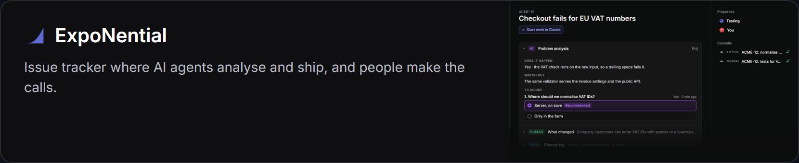
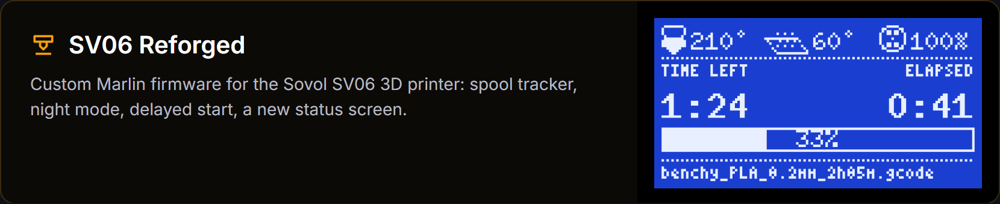

### More projects

- **[Najemnik](https://najemnik-demo.onrender.com)**: real monthly and move-in cost of rentals, offers side by side. Python, FastAPI, HTMX.
- **[Switchboard for Claude Code](https://github.com/Wheatlay/switchboard-for-claude-code)**: switch Claude Code accounts per window or repo, plan limits in the status bar. VS Code extension.
- **[Stateful Buttons](https://github.com/Wheatlay/stateful-buttons)**: VS Code status bar buttons that run commands and show live ON/OFF state.
- **[OrcaSlicer + MCP](https://github.com/Wheatlay/orcaslicer-mcp)**: my OrcaSlicer fork with a local API and an MCP server, so Claude can load models, tune settings, slice and analyse.
- **[Compact Notifications](https://github.com/Wheatlay/compact-notifications)**: Windhawk mod that reworks Windows notification banners into compact cards.

Interactive CV with project pages and demos: **[wheatlay.is-a.dev](https://wheatlay.is-a.dev)**

